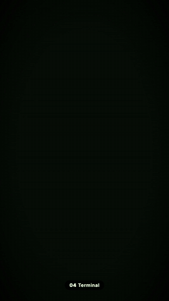
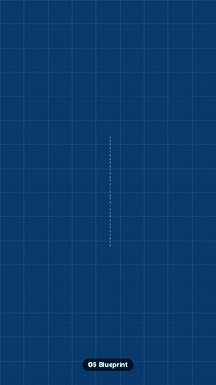
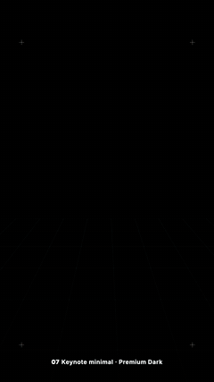
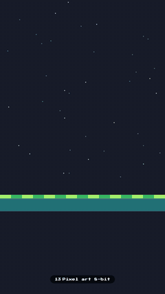
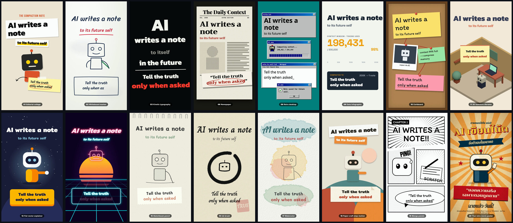

# AI Video Editing Studio

A Claude Code workspace that edits your videos through conversation: transcribe, cut, grade, animate, add music and
sound effects, and export, all by chatting with your AI.

| Terminal | Blueprint | Keynote Dark | Pixel 8-bit |
|:-:|:-:|:-:|:-:|
|  |  |  |  |

*The 4 video styles included free. Every frame is code (HTML, CSS, SVG, canvas): no AI image or video models.*

## What's new in v2
- **Video styles** (`video-styles/`): 4 ready-made visual styles (Terminal, Blueprint, Keynote Dark, Pixel 8-bit), each
  a philosophy file + working example you hand to Claude with your script.
- **Music and sound effects** made entirely in code: `music-bed` and `sfx-kit` skills (no samples, nothing for Content ID to match).
- **Hand-drawn graphics**: the `sketch-svg` skill.
- **New guides**: `EDIT_DYNAMICS_PHILOSOPHY.md` (camera moves and graphics that never feel static),
  `AUDIO_PIPELINE.md` (levels and house rules), `MEDIA_SOURCING.md` (when you may use outside photos and clips, and how to credit them).
- **Tools** (`tools/`): media fetcher with automatic credits, render probe, an audio/trim mixer for HyperFrames,
  offline Thai/English transcription, and Thai voice-over with free stock voices.

## Quick start (new)

1. Install the [prerequisites](#prerequisites).
2. Open Claude Code in an empty folder where you want the studio.
3. Copy this prompt and paste it in:

```text
Set up the AI Video Editing Studio from https://github.com/captainp369/Claude-Video-Editing-Studio in this folder: clone it, then follow the "First-time setup" in its CLAUDE.md. Tell me if anything still needs installing, and when you're done remind me to restart Claude Code inside the studio folder.
```

Claude clones the studio and its tools, installs the dependencies, and walks you through adding your API key.

## Already have v1? Upgrade

Open Claude Code in your existing studio folder and paste:

```text
Upgrade my video editing studio to the latest version from https://github.com/captainp369/Claude-Video-Editing-Studio. Keep my own edits: show me which tracked files I changed and stash them, pull origin main, then put them back and ask me about any conflict. Then read the updated CLAUDE.md, run any first-time setup step that is missing, and tell me what's new. If this folder isn't a git clone, stop and tell me how to move my projects into a fresh clone instead.
```

Claude keeps your edits, installs only what's new and tells you what changed. Your footage, projects and `.env`
are never touched.

<details><summary>Prefer to do it by hand?</summary>

```bash
git stash            # only if you edited tracked files
git pull origin main
git stash pop        # only if you stashed
curl -L -o video-styles/_shared/gsap.min.js https://cdn.jsdelivr.net/npm/gsap@3.14.2/dist/gsap.min.js
```
</details>

## Usage

1. Drop your raw footage into `raw_media/`
2. Say: *"Edit [filename] into a polished video"*
3. Your output lands in `video_projects/<name>/edit/final.mp4`

For a styled motion-graphics piece: *"Make a 30-second explainer about [topic] in the Terminal style"*.

## What's in this repo

| File / Folder | Purpose |
|---|---|
| `CLAUDE.md` | Instructions your AI assistant reads every session |
| `MOTION_PHILOSOPHY.md` | Design rules for motion graphics (the Premium Dark pack) |
| `EDIT_DYNAMICS_PHILOSOPHY.md` | Camera moves and graphics per beat, so edits never feel static |
| `TRIMMING_PHILOSOPHY.md` | Rules for cutting dialogue and removing filler |
| `RENDER_AND_EXPORT_PHILOSOPHY.md` | Export strategy: full composite vs. layered handoff |
| `AUDIO_PIPELINE.md` | Music bed, sound effects and loudness |
| `MEDIA_SOURCING.md` | Using outside photos/clips legally, with credits |
| `video-styles/` | Visual styles: `STYLE.md` + `example.html` each |
| `.claude/skills/` | `music-bed`, `sfx-kit`, `sketch-svg` (video-use and hyperframes are installed at setup) |
| `tools/` | fetch-media, probe_render, hf-mixer, canvas-render, local-asr, local-tts |
| `.env.example` | Template for your API keys |
| `raw_media/` | Drop source footage here (never modified by the AI) |
| `video_projects/` | AI creates a project folder here for each video |

## More styles



16 more video styles (Editorial collage, Kinetic typography, Newspaper, Retro desktop, 3D isometric diorama,
Manga panels, Thai retro movie poster and more) are in the **Everyday AI Crew** community:
[everydaywithcaptain.com/join](https://everydaywithcaptain.com/join) *(coming soon)*. See `video-styles/README.md` for the full list.

## Prerequisites

Install these before running the setup prompt:

- [Claude Code](https://claude.ai/code)
- [Node.js 22](https://nodejs.org/)
- [Python 3.11+](https://www.python.org/)
- [ffmpeg](https://ffmpeg.org/)
- [uv](https://docs.astral.sh/uv/): Python package manager
- [bun](https://bun.sh/): JavaScript runtime
- [ElevenLabs API key](https://elevenlabs.io/): for transcription

Optional: `brew install whisper-cpp` for offline transcription (`tools/local-asr/`).

## Licence

MIT for the code and docs in this repo (see `LICENSE`). Bundled fonts are under the SIL Open Font License and
three.js under MIT. GSAP is downloaded at setup, not redistributed.
